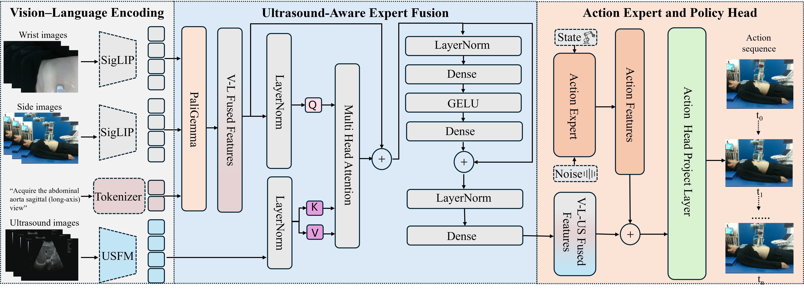

<div align="center">

# US-VLA: An Ultrasound Vision-Language-Action Model for Embodied Abdominal Scanning

**Accepted to ACM MM 2026**

</div>

---

## Overview

**US-VLA** is one of the first **vision–language–action (VLA)** frameworks tailored for **automated abdominal ultrasound scanning**. It explicitly encodes clinical semantic goals and generates sequential probe-manipulation actions under **real-time ultrasound feedback**.

Unlike conventional reinforcement-learning or imitation-based ultrasound automation that relies on hand-crafted reward functions or low-level motion supervision, US-VLA augments a pre-trained vision–language model with a dedicated **ultrasound image encoder** and an **ultrasound-aware expert fusion module**. This injects task-relevant ultrasound semantics into the action-generation pathway, enabling closed-loop and standardized acquisition of clinically meaningful standard planes with improved stability and generalization across organs, scanning targets, and diverse clinical conditions.

To support this task, we further construct [**US-VLA-Data**](https://huggingface.co/datasets/usvla/US), a real-world dataset covering liver and kidney examinations with five clinically defined standard planes, comprising **320 expert scanning trajectories** and approximately **80,000 synchronized timesteps**.

---

## Code Release

Due to intellectual property considerations and an ongoing patent/productization process, the training and inference code is **temporarily withheld**. It will be released in accordance with our institutional policy once the IP review is complete. Researchers interested in collaboration or reproduction are welcome to **contact the authors**.

---

## Dataset

**US-VLA-Data** has been **partially released** and is publicly available on Hugging Face as [**US**](https://huggingface.co/datasets/usvla/US):

<div align="center">

| Dataset | Hugging Face |
| :---: | :---: |
| US-VLA-Data (partial release) | [🤗 usvla/US](https://huggingface.co/datasets/usvla/US) |

</div>

The full dataset comprises **320 expert scanning trajectories**. Currently, a subset of **120 episodes** collected from **3 operators** has been released. Researchers who need the complete dataset are welcome to **contact the authors** to request access.

---

## Framework

<div align="center">
  
</div>

The framework consists of three main components:

- **(1) Vision–Language Encoding.** RGB images from the wrist-mounted and side-view cameras are encoded by a **SigLIP** visual encoder, and clinical task instructions describing the target standard plane are tokenized and embedded by a language encoder. Ultrasound images are encoded separately by a universal **US foundation model (USFM)** to avoid the domain mismatch between natural and ultrasound images. A **PaliGemma** backbone aligns the visual and language streams into fused vision–language representations.

- **(2) Ultrasound-Aware Expert Fusion.** A cross-modal attention module injects real-time ultrasound feedback into the decision process: the vision–language features serve as **queries** while the ultrasound features serve as **keys/values**, followed by residual connections and a feed-forward expert block that produces ultrasound-modulated action features.

- **(3) Action Expert and Policy Head.** Conditioned on the fused representations and the robot state, an action expert and policy head map the features to **continuous, sequential probe-control commands** under closed-loop ultrasound guidance.

---

## Citation

If you find US-VLA useful, please cite:

```bibtex
@inproceedings{usvla2026,
  title     = {US-VLA: An Ultrasound Vision-Language-Action Model for Embodied Abdominal Scanning},
  booktitle = {Proceedings of the 34th ACM International Conference on Multimedia (ACM MM)},
  year      = {2026},
}
```

## Acknowledgements

- [openpi](https://github.com/Physical-Intelligence/openpi): the model implementation follows the openpi codebase of pi0/pi05.
- [USFM](https://github.com/openmedlab/USFM): the ultrasound foundation model used as the ultrasound image encoder.
- [LeRobot](https://github.com/huggingface/lerobot): dataset format and data loading.
